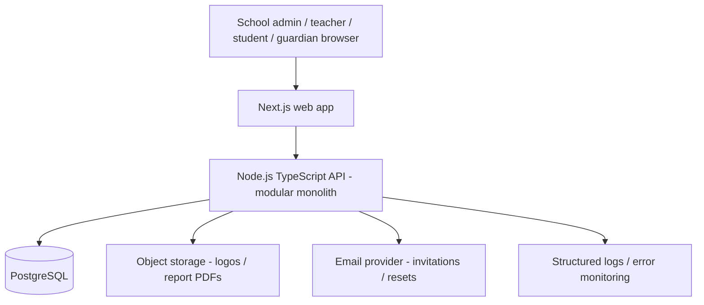

# Architecture — Build First, Scale Later

**Architecture decision:** Start with **one modular monolith**, **one PostgreSQL database**, **one responsive Next.js frontend**, and **one Node.js/TypeScript API**. Avoid microservices, Kubernetes, Kafka, Temporal, and distributed databases until needed.

## 1. MVP deployment diagram


**Smallest working vertical slice:** School + admin login → create class → add student → teacher attendance → student views attendance. Build this before fees, results or visual polish.

## 2. Stack choices
| Concern | MVP choice | Why |
|---|---|---|
| Frontend | Next.js + TypeScript + Tailwind | Responsive role-based UI |
| Backend | Express + TypeScript + Zod | Familiar, minimal and explicit |
| ORM / DB | Prisma + PostgreSQL | Relational consistency and migrations |
| Auth | Secure server-side sessions in HttpOnly cookies | Easy revocation and browser security |
| File storage | S3-compatible object storage | School logos, generated PDFs |
| Emails | Transactional email provider | Invitations and resets |
| PDF | Server-side report card/receipt rendering | Consistent documents |
| Development | Docker Compose for Postgres | Reproducible local environment |
| Tests | Vitest + Supertest + Playwright | Unit, API, browser E2E |

Redis is **not required** for the first vertical slice. Add Redis/BullMQ only when background jobs, rate limits, or caching justify it. Do not store the source of truth for fees or results in Redis.

## 3. Repository structure
```text
schoolos/
  apps/
    web/                     # Next.js
    api/                     # Express TS
      src/
        modules/
          auth/ schools/ memberships/ academics/
          students/ attendance/ exams/ fees/ notices/
        middleware/          # auth, tenant, RBAC, errors
        lib/                 # db, logger, storage
        app.ts
        server.ts
      prisma/schema.prisma
  packages/
    shared/                  # zod schemas, types, constants
  docs/                      # these six markdown files
  docker-compose.yml         # postgres only initially
  .env.example               # no real credentials
```

## 4. Data model: minimum viable entities
- `School(id, slug, name, address, logoUrl, primaryColor, status)`
- `Subscription(id, schoolId, plan, status, startsAt, endsAt, graceEndsAt)`
- `User(id, email?, phone?, passwordHash?, status)`
- `Membership(id, schoolId, userId, role, status)` (unique schoolId+userId+role as appropriate)
- `AcademicSession(id, schoolId, name, startDate, endDate)`
- `Class(id, schoolId, sessionId, name)`; `Section(id, schoolId, classId, name)`
- `Subject(id, schoolId, name)`; `TeachingAssignment(id, schoolId, teacherMembershipId, sectionId, subjectId?)`
- `Student(id, schoolId, admissionNumber, name, dob?, status)`
- `Enrollment(id, schoolId, studentId, sessionId, sectionId, rollNumber, status)`
- `GuardianLink(id, schoolId, guardianMembershipId, studentId, relationship, verifiedAt)`
- `Attendance(id, schoolId, enrollmentId, date, status, markedBy, updatedAt)`
- `Exam(id, schoolId, sessionId, name, status)`; `ExamSubject(id, schoolId, examId, subjectId, maxMarks)`
- `Mark(id, schoolId, examSubjectId, enrollmentId, marks, enteredBy, updatedAt)`
- `FeeCharge(id, schoolId, studentId, sessionId, head, amount, dueDate)`
- `FeePayment(id, schoolId, studentId, amount, method, receiptNumber, receivedAt, reference)`
- `FeeAllocation(id, schoolId, paymentId, chargeId, amount)`; `FeeAdjustment(...)`
- `Notice(id, schoolId, title, body, publishedAt)`
- `AuditLog(id, schoolId, actorId, action, entityType, entityId, timestamp, metadata)`

Use decimal or integer minor currency units for INR, never floating-point arithmetic. Every financial mutation uses a database transaction. Keep fee payments and charges rather than overwriting a single `paid` boolean.

## 5. Tenant resolution and authorization
1. Resolve school via validated subdomain/slug or explicit route such as `/s/:schoolSlug`.
2. Load authenticated session and active membership for the resolved school.
3. Authorize role **and** ownership/assignment for the specific resource.
4. Query database using `schoolId` plus resource IDs; verify referenced records belong to same school.
5. Reject missing/mismatched tenant access with 403/404; never trust a client-supplied `schoolId`.
6. Add PostgreSQL Row-Level Security later as defense in depth after application-layer enforcement is correct.

Example: a teacher can submit attendance only for sections assigned to their membership. A guardian sees only students linked via verified `GuardianLink`. The platform admin is **not** implicitly allowed to read child data.

## 6. API sketch (versioned REST)
```text
POST   /api/v1/auth/login
POST   /api/v1/auth/logout
POST   /api/v1/invitations/accept
GET    /api/v1/me
GET    /api/v1/s/:slug/branding
POST   /api/v1/s/:slug/students
POST   /api/v1/s/:slug/students/import
GET    /api/v1/s/:slug/sections/:id/students
PUT    /api/v1/s/:slug/sections/:id/attendance/:date
POST   /api/v1/s/:slug/exams
PUT    /api/v1/s/:slug/exams/:id/marks
POST   /api/v1/s/:slug/exams/:id/publish
GET    /api/v1/s/:slug/me/results
POST   /api/v1/s/:slug/fees/charges
POST   /api/v1/s/:slug/fees/payments
GET    /api/v1/s/:slug/me/fees
```
Validate payloads with Zod, paginate lists, enforce consistent error format and audit sensitive mutations.

## 7. Delivery stages
### Stage A — Run locally (first milestone)
- Docker Postgres + migrations + seed two schools.
- School admin login and school-scoped dashboard.
- Create class, section, student, teacher assignment.
- Attendance entry and student attendance view.
- Automated test: School A cannot access School B.

### Stage B — Complete usable MVP
- Invite/verify users and guardian linking.
- Exams, marks, publish workflow, basic PDF report.
- Fee charges, partial offline payments, receipt and balance.
- CSV import, notices, branding, subscription states, data export.
- Production security, backup and recovery rehearsal.

### Stage C — Pilot hardening
- Pilot data migration, error reporting, admin usability, rate limiting.
- Audit dashboard, monitoring, load tests and UAT with real school workflows.

### Stage D — Scale only when measured
- Add Redis/BullMQ for emails, imports and PDF jobs.
- Add read caching and indexes based on query metrics.
- Use managed Postgres, connection pooling, read replicas if justified.
- Add payment gateway, mobile apps, multilingual UI and optional modules.
- Consider service extraction only when team ownership, deployment or scaling requires it.

## 8. Security, operations and reliability
- Use HTTPS, Secure/HttpOnly/SameSite cookies, CSRF protection where relevant, password hashing, login throttling, validation and secure upload rules.
- Maintain audit logs for marks, attendance corrections, fee entries and role changes.
- Configure database backups and test restore before real school data is stored.
- Separate dev/staging/production; secrets only in environment/secret manager.
- No sensitive personal data in logs; scoped support access; enforce retention and deletion policies.
- Provide health endpoint, structured logs and error alerts.

## 9. ADRs (architecture decision records)
- **ADR-001:** Modular monolith, not microservices — fastest deployable MVP.
- **ADR-002:** Shared PostgreSQL tables with `schoolId` — inexpensive, manageable multi-tenancy.
- **ADR-003:** Config-driven branding — no school-specific forks.
- **ADR-004:** Offline fee ledger before online payments — reduce payment integration complexity.
- **ADR-005:** Web first — reduce maintenance and time to pilot.
- **ADR-006:** Redis optional — avoid infrastructure without measured need.

## 10. What not to build now
Kubernetes cluster, event streaming platform, custom auth framework, AI analytics, complex billing engine, distributed cache, separate database per school, native apps, or a fully customizable website builder.
